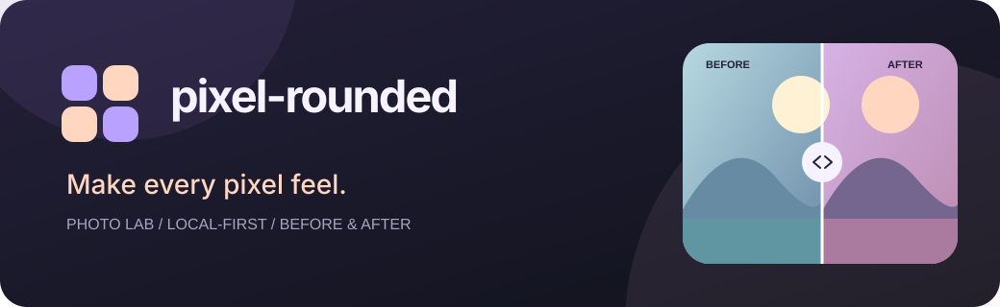
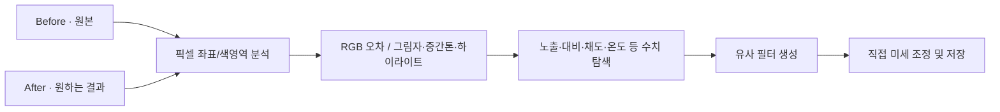

<p align="center"></p>

<div align="center">

# pixel-rounded ♡

**Make every pixel feel.**  
픽셀 하나하나에 감각을 더하다.

사진 한 장에도 온도가 있어요.  
**내 손에서, 오프라인으로, 픽셀까지 살펴보며** 사진을 변화시키는 작은 아틀리에.

[🎨 Figma Design](https://www.figma.com/design/cBXdSYzTdooU7EVYU2bMnV) · [📷 사진 기법](docs/PHOTOGRAPHY.md) · [🧪 테스트 계획](docs/TEST_PLAN.md) · [🍑 기여하기](CONTRIBUTING.md)

</div>

---

## 이 앱에서 할 수 있는 것

| 기능 | 사용 경험 |
|---|---|
| ✦ 7가지 사진 프리셋 | 아날로그의 오후, 벨벳 필름, 봄날의 빛, 모노 노트, 라벤더 아워, 둥근 픽셀 등 |
| 🌤️ 10개 편집 항목 | 노출·대비·채도·색온도·입자·블룸·페이드·비네팅·픽셀 크기·곡률 |
| ◐ 드래그 전후 비교 | 같은 사진의 Before/After를 하나의 창에서 시각적으로 비교 |
| ▦ 픽셀 연구 | 좌표별 RGB HEX, 그림자·중간톤·하이라이트 색 영역 설명 |
| ♡ 전후 사진으로 필터 생성 | 같은 장면의 원본/완성본에서 픽셀 차이를 계산해 전역 색감 파라미터 근사 |
| ↶ Undo / Redo | 슬라이더 편집과 프리셋 전환을 되돌리고 다시 실행 |
| 📁 로컬 저장 | PNG 무손실/JPG, 원본 해상도 재처리, 서버 업로드 없음 |
| 🔐 Secure Electron | Sandboxed 렌더러, 제한된 IPC, 전용 리소스 프로토콜 및 CSP |

데스크톱 앱은 Electron이며 React나 무거운 이미지 프레임워크 없이 **순수 JavaScript + Canvas + CSS** 기반으로 동작합니다. 원본을 보존한 채 편집본을 만들어 내보내요.

## 시작하기

**요구사항:** Node.js 22 이상, npm, 개발환경에 Electron 바이너리를 설치할 네트워크 연결.

```bash
git clone https://github.com/hslcrb/pixel-rounded-app.git
cd pixel-rounded-app
npm install
npm run verify
npm start
```

Windows 설치·포터블 빌드 설정:

```bash
npm run dist:win
```

Linux AppImage 설정:

```bash
npm run dist:linux
```

실제 패키징은 OS별 도구와 종속성을 설치해야 가능합니다. **현재 소스 코드가 제공된 개발 단계이며, 검증된 Windows 실행파일이 업로드됐다는 뜻은 아닙니다.** 자세한 내용은 [릴리스 가이드](docs/RELEASE.md)를 확인해 주세요.

## 사용법

1. 처음 열면 직접 제작한 풍경 일러스트가 보입니다. **사진 열기** 또는 파일 드롭으로 PNG/JPEG/WebP 사진을 가져오세요.
2. 왼쪽 프리셋을 고르거나 오른쪽 슬라이더로 원하는 질감을 조정해요.
3. 가운데 ◐ 비교 핸들을 움직이며 변화량을 살펴보세요. 사진 위로 포인터를 움직이면 픽셀 좌표와 Before/After 색을 알 수 있어요.
4. **전후 사진으로 필터 만들기**에는 같은 장면의 완성본 사진을 넣으세요. 색감 차이로부터 자동으로 설정을 제안해요.
5. 준비되면 PNG/JPG로 저장! 원본과 편집 결과물을 구분해 보관하세요.

**단축키:** Ctrl/Cmd+O 열기 · Ctrl/Cmd+S 저장 · Ctrl/Cmd+Z 되돌리기 · Ctrl/Cmd+Shift+Z 다시 실행 · 비교 프레임 선택 후 ←/→ 핸들 이동.

이미지는 현재 입력 바이너리 36MiB 이하, 디코딩 후 최대 **24메가픽셀**을 지원하며, 미리보기는 장변 최대 1400px로 축소해 처리합니다. EXIF/ICC/RAW는 현재 미지원입니다.

## 전후 사진을 픽셀 단위로 분석하는 방법



현재는 고전적인 수치 최적화로 **전역 색감**을 근사합니다. 두 이미지의 구도나 피사체가 다르거나, 국소 마스킹·합성·강력한 공간 효과가 포함되어 있다면 그대로 복제할 수는 없습니다. 결과에 표시하는 %는 **픽셀 MSE 오차 감소율**이지 정확도나 AI 신뢰도가 아닙니다.

[기법과 이론](docs/PHOTOGRAPHY.md) · [알고리즘 명세](docs/FILTERS.md) · [전후 사진 워크플로](docs/REFERENCE_WORKFLOW.md)

## 나만의 사진은 나만의 것

- 사진 자동 업로드·분석 서버·트래커·광고 SDK 없음.
- 데이터는 열린 앱 안에서 처리하고 파일은 사용자가 지정한 곳에 저장해요.
- 업로드가 없다는 사실과 앱 자체의 시스템 보안이 완벽하다는 사실은 다릅니다. 의존성 업데이트와 실제 OS 테스트가 필요해요.
- 사진 및 결과물의 저작권은 사진을 촬영·보유한 해당 권리자의 조건을 따릅니다.

## 라이선스와 공개 개발

> **중요:** 현재 `PR-SAL-1.0`은 자체적인 **source-available 라이선스**입니다. **OSI 승인 오픈소스 라이선스가 아닙니다.**

소스 열람, 개인 학습·사용, 비공개 수정, 공식 프로젝트 기여를 허용하지만 일반적인 무단 재배포·파생 앱 판매·상업적 이용을 제한합니다. 권리 보호와 공식 협업 참여를 함께 제공하기 위해 선택한 모델이며, '오픈소스'와 혼동하면 안 됩니다.

[LICENSE](LICENSE) · [라이선스 안내](docs/LICENSE_GUIDE.md) · [IP 정책](docs/IP_POLICY.md) · [CONTRIBUTING](CONTRIBUTING.md) · [AGENTS.md](AGENTS.md) · [보안](SECURITY.md)

## 프로젝트 안내서

| 문서 | 담긴 내용 |
|---|---|
| [브랜딩](docs/BRAND.md) | 철학, 로고, 컬러, 감성 키워드 |
| [아키텍처](docs/ARCHITECTURE.md) | renderer / main / IPC / 필터 / 최적화 |
| [사진 기법](docs/PHOTOGRAPHY.md) | 노출·대비·색온도·필름·블룸 등 원리 |
| [필터 명세](docs/FILTERS.md) | 정확한 수학·제약·입출력 |
| [참조 사진 워크플로](docs/REFERENCE_WORKFLOW.md) | 두 장으로 색감 필터를 만드는 과정 |
| [테스트 계획](docs/TEST_PLAN.md) | 검증 증거와 아직 미실행한 GUI/실사진 체크 |
| [로드맵](docs/ROADMAP.md) | Curves/RAW/마스크/자동 정렬 등의 개선 |
| [릴리스](docs/RELEASE.md) | 설치·패키징·서명·수동 검증 |
| [개발 결정](docs/DECISIONS.md) | 왜 이런 아키텍처·라이선스를 선택했는지 |
| [작업 기록](docs/WORK_LOG.md) | 브랜치와 단계별 작업 이력 |

---

<p align="center"><strong>Rounded pixels. Softer memories. ♡</strong><br /><sub>© 2026 Rheehose / hslcrb · pixel-rounded · PR-SAL-1.0</sub></p>
