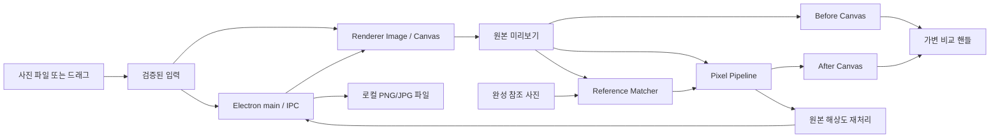

# 아키텍처 · Local-first Photo Lab

## 구성



Native OS 파일 다이얼로그, Electron BrowserWindow, 필터 엔진, 렌더러와 매칭 엔진의 책임을 분리합니다. 참조 사진은 file input으로 렌더러에 로드하고 업로드하지 않습니다.

## 폴더

```text
src/
  main.js                 Electron 엔트리, 안전한 리소스/파일 IPC
  preload.js              두 가지 권한만 공개
  assets/                 직접 제작 SVG
  renderer/
    index.html            한글·접근성 UI
    style.css             토큰 기반 다크 라벤더 디자인
    filters.js            10개 조절 항목
    matcher.js            전후 사진 룩 역추정
    renderer.js           사용자 상호작용
test/                      Node 내장 test
docs/                      브랜딩·라이선스·기술 및 테스트 문서
.github/                   PR·Issue 양식
```

## 보안 경계

- 원격 웹사이트 로드 X. 자체 `pixelrounded://app/` origin의 번들 파일만 응답.
- `nodeIntegration:false`, `contextIsolation:true`, `sandbox:true`.
- IPC sender 검증 후 형식, 이미지 매직 바이트, 파일 크기, 경로 정책 검사.
- file:// 전체 파일 시스템 노출을 피하고 자체 프로토콜 안에서 경로를 제한.
- 사용자 사진 외부 통신 X. 다운로드 추적, 광고 SDK, 분석 SDK 없음.
- 메모리 상 한도 24MP, 입력 바이너리 36MiB, 저장 바이너리 128MiB.

## 구현의 트레이드오프

- 의존성 없는 Canvas 엔진이라 설치는 간단하지만 현재 픽셀 처리 과정은 메인 UI 스레드에서 실행되어 큰 이미지 프리뷰에 순간적인 일시 정지가 있을 수 있습니다.
- 미리보기는 다운샘플, 저장은 전체 크기 재연산하므로 특히 둥근 픽셀 효과는 픽셀 셀 크기가 출력 해상도 기준으로 달라 보일 수 있습니다.
- 참조 매칭은 전역 조절을 추정하므로 사진 전체의 정확한 텍스처/광학 구조를 복원하는 기능이 아닙니다.
- 마우스 픽셀 검사 좌표는 원본 해상도에 비례로 매핑하지만 RGB 채널 값은 미리보기 데이터에서 읽습니다.
- 앱 바이너리는 서명되지 않은 상태. 정식 배포 전 빌드 검증 및 코드 서명이 필요합니다.
